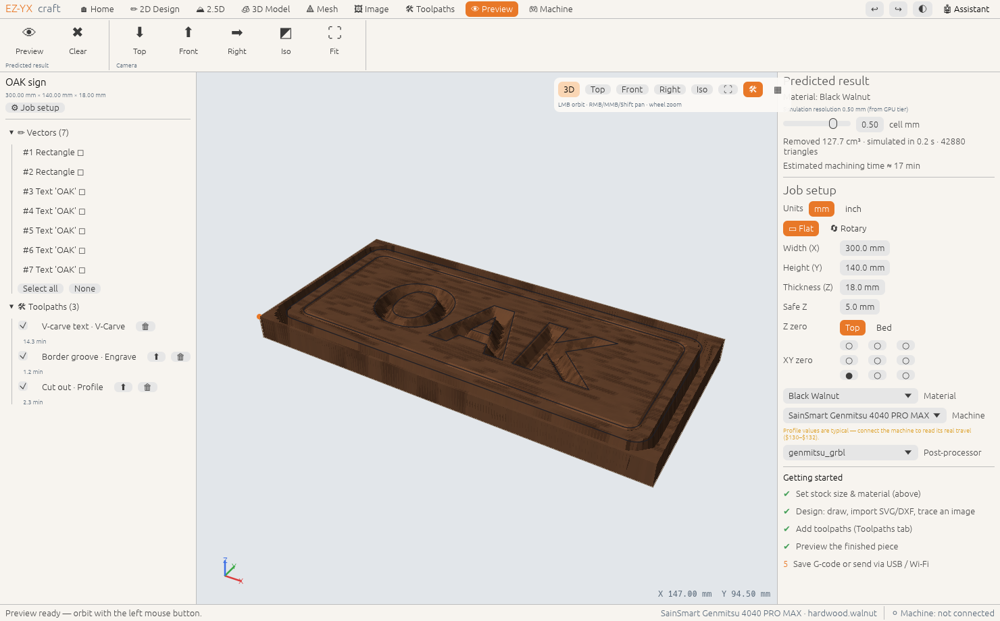
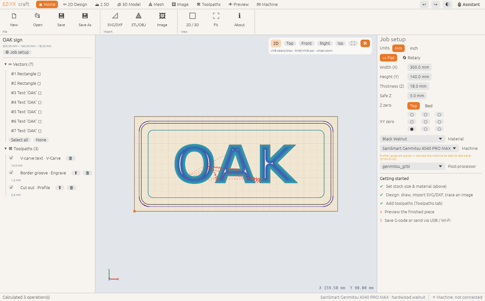
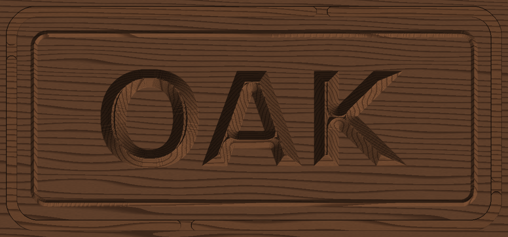

# EZ-YX-craft

**Open-source CNC design, CAM, preview and machine control for wood & metal carving — written in Rust.**

EZ-YX-craft aims for the depth of professional carving suites with the friendliness of
browser-based beginner tools: a ribbon of clear modules, sensible defaults everywhere, a
"predicted result" preview in your actual material, and an AI assistant that can do the clicking
for you.



| 2D design & toolpaths | Headless simulation render (`ezyx sim`) |
|---|---|
|  |  |

## Highlights
| Module | What you can do |
|---|---|
| **2D Design** | Rectangles, circles, polygons, stars, polylines, TrueType text; offset, weld/subtract/intersect, centre, transform; SVG & DXF import |
| **2.5D** | Image → relief, dome/pillow from vectors, mesh → relief |
| **3D Model** | Feature-tree part design (box/cylinder/sphere/cone/torus, extrude & revolve sketches, cut/intersect, blends, fillets, shells, linear/circular patterns) |
| **Mesh** | STL/OBJ import/export, fit to stock, smoothing, **tetrahedral meshing** with quality metrics (VTK / Gmsh export) |
| **Image** | Logo/sketch → outline vectors, **pen sketch → single-line engrave**, **photo V-carve** (shaded photos as V-grooves), image → 2.5D relief, image → 3D (offline inflation; pluggable AI backends) |
| **Toolpaths** | Profile (inside/outside/on, tabs, ramps, finish pass), pocket (offset/raster), **V-carve** (incl. flat-bottom + clearance tool), drill (peck), engrave, laser, **3D roughing/finishing** (drop-cutter for flat/ball/V/tapered), **rotary wrapping** & rotary 3D |
| **G-code** | Posts for GRBL, **Genmitsu** (3018…4040 PRO MAX), Genmitsu laser, **xTool** (GRBL mode), FluidNC/grblHAL, **Makera Carvera** (ATC), LinuxCNC, Mach3/4, Marlin — data-driven JSON posts |
| **Tool library** | Full **SainSmart Genmitsu** bit table with community feeds & speeds (auto-rescaled for your machine) + generic templates for other retailers; chip-load calculator |
| **Preview** | Material-removal simulation rendered in walnut, maple, oak, MDF, plywood, aluminium, brass, copper, acrylic… with machining advice (scallop height, burn risk, overload) |
| **Machine** | Control over **USB serial, Wi-Fi (TCP/telnet & WebSocket)** or the built-in simulator: DRO, jog pad, home/unlock, zero, Z-probe, run/pause/stop, overrides, console, LAN scan |
| **AI assistant** | Claude, OpenAI or local Ollama with tool calling — it edits your project, picks bits, computes toolpaths and (with your confirmation) runs the machine |
| **GPU** | Detects NVIDIA RTX/GTX, AMD RDNA/GCN/TeraScale (old Radeons fall back to OpenGL), Intel, Apple; tunes simulation & viewport detail per tier |

## Install / build
Prebuilt installers (.deb/.AppImage, .dmg, .msi) are produced by the release workflow. From source:

```bash
# Ubuntu prerequisites (GUI)
sudo apt install build-essential pkg-config libxkbcommon-dev libwayland-dev libx11-dev \
  libxcursor-dev libxrandr-dev libxi-dev libgl1-mesa-dev
# Rust ≥ 1.85
curl https://sh.rustup.rs -sSf | sh

cargo run -p ezyx-app --release          # desktop app
cargo run -p ezyx-cli --release -- help  # command line
```
macOS and Windows need only Rust (and Xcode CLT / MSVC build tools).

## CLI quick tour
```bash
ezyx demo -o sign.ezyx --text "OAK"     # demo project: V-carved text + border + cut-out
ezyx gcode sign.ezyx --post genmitsu_grbl
ezyx sim sign.ezyx -o preview.png       # predicted result as an image
ezyx trace logo.png --width 120         # image → vectors
ezyx photo-vcarve portrait.jpg -o portrait.nc --tool generic.v60
ezyx img3d cat.png -o cat.stl --thickness 15
ezyx tetmesh -o part                    # demo CAD part → part.vtk + part.msh
ezyx send sign.nc --tcp 192.168.1.50:23 # stream over Wi-Fi (or --serial /dev/ttyUSB0, --sim)
ezyx scan 192.168.1                     # find Wi-Fi controllers
ezyx ask sign.ezyx "add a 3 mm chamfer-style V groove 8 mm inside the border"
```

## AI assistant
Settings → choose **Claude** (Anthropic API key), **OpenAI** (API key) or **Ollama** (local, free).
Keys can come from `ANTHROPIC_API_KEY` / `OPENAI_API_KEY`. The assistant works through the same
command API as the GUI, so every change is undoable; anything that moves the machine or writes
files requires your click.

## Status
v0.1 is a working foundation: all engines are implemented and unit-tested headless; the GUI is
complete in layout and flows. Hardware testing on real machines (especially the Genmitsu Wi-Fi
module protocol) is the next milestone — see [docs/ROADMAP.md](docs/ROADMAP.md).

## Docs
* [Architecture](docs/ARCHITECTURE.md) · [Feature matrix vs. VCarve/Aspire/Easel](docs/FEATURE_MATRIX.md)
* [Machine control & Wi-Fi](docs/MACHINE_CONTROL.md) · [Roadmap](docs/ROADMAP.md) · [Contributing](CONTRIBUTING.md)

## Credits & license
Dual-licensed **MIT OR Apache-2.0**. Bundled bit data: *SainSmart Genmitsu bit table V6.0*,
compiled by Graham Bland for the Genmitsu user community — used with attribution; verify values
with test cuts. VCarve, Aspire, Easel, Genmitsu, xTool, Makera, Carvera are trademarks of their
owners; EZ-YX-craft is an independent project and not affiliated with them.
