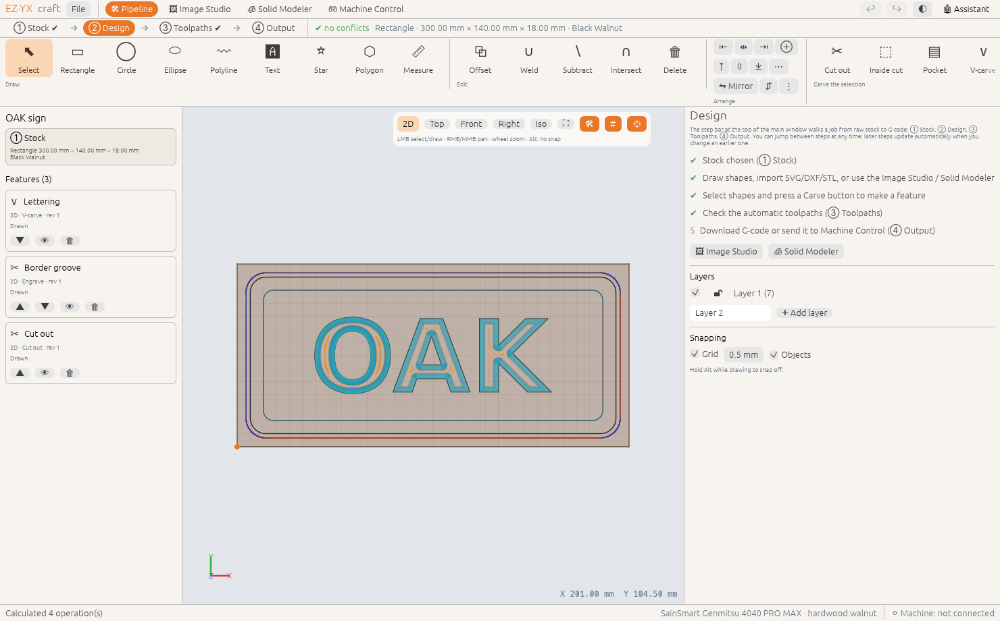
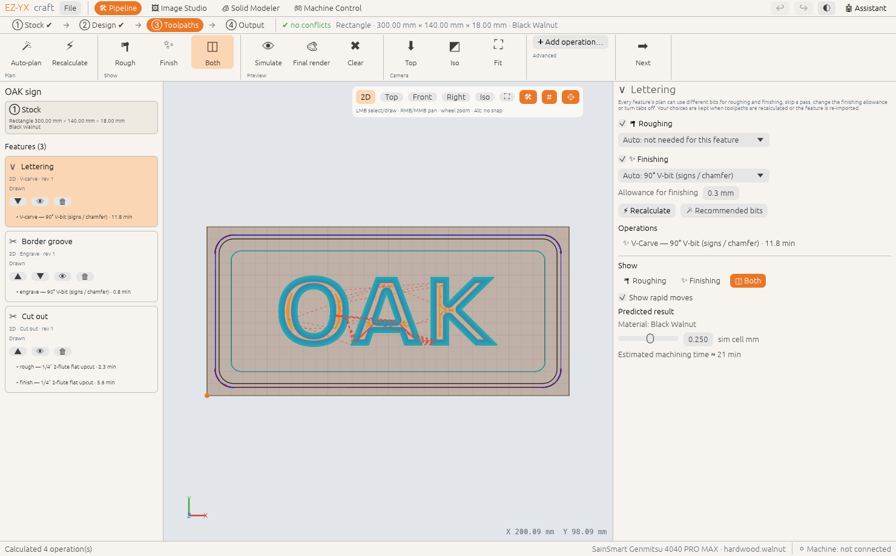
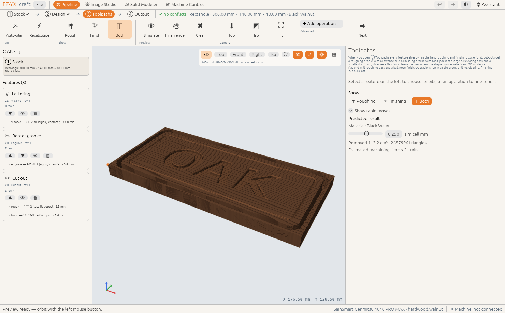
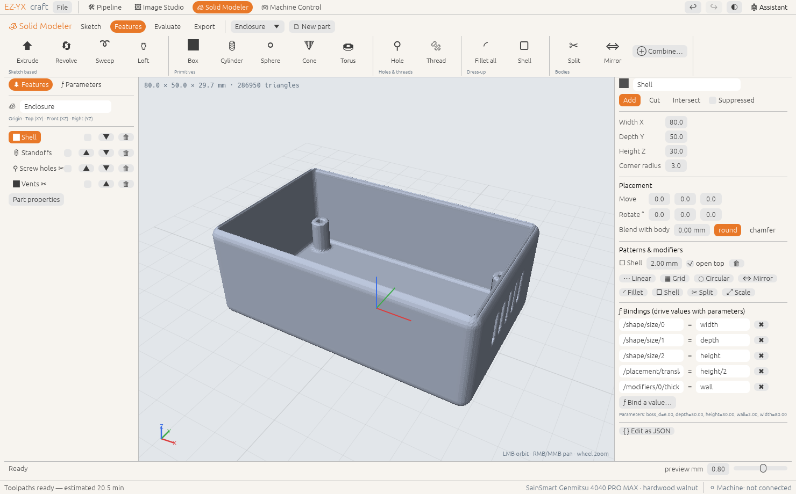
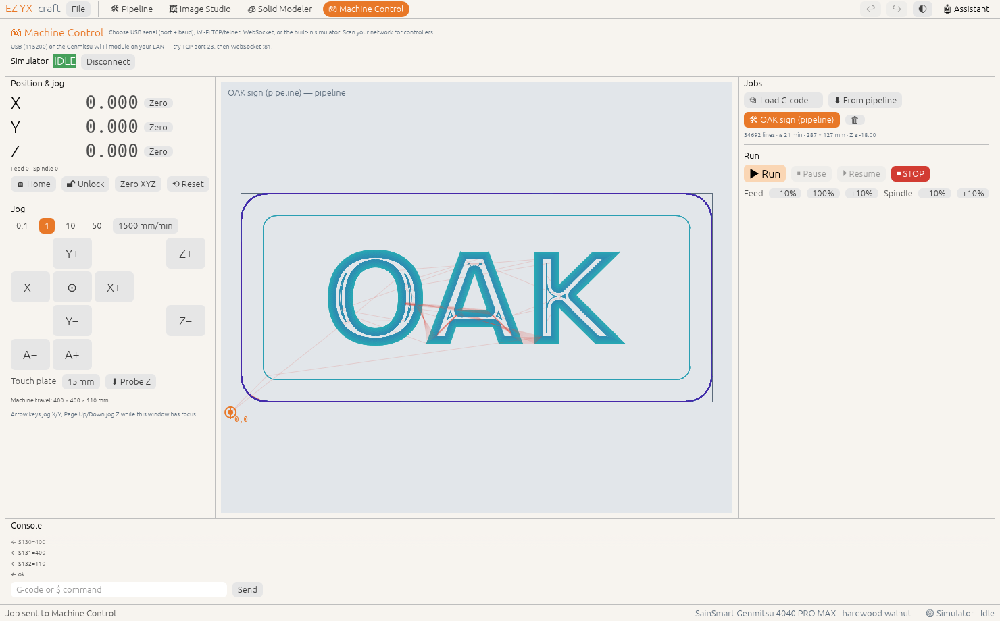

# EZ-YX-craft

**Open-source CNC design, CAM, preview and machine control for wood & metal carving — written in Rust.**

EZ-YX-craft aims for the depth of professional carving suites with the friendliness of
browser-based beginner tools: one clear **pipeline** (① Stock → ② Design → ③ Toolpaths → ④ Output)
with automatic roughing + finishing plans, separate **Image Studio**, **Solid Modeler** and
**Machine Control** windows that feed it, a "predicted result" preview in your actual material, and
an AI assistant that can do the clicking for you.



| ③ Toolpaths: automatic rough + finish | Predicted result in walnut |
|---|---|
|  |  |
| **Solid Modeler** (parametric, constrained sketches) | **Machine Control** (USB / Wi-Fi / simulator) |
|  |  |

📖 **[User manual](docs/manual/src/introduction.md)** — generated and kept up to date by the docs
pipeline (see [CONTRIBUTING](CONTRIBUTING.md#user-manual)).

## Highlights
| Module | What you can do |
|---|---|
| **Pipeline ① Stock** | Material (woods, MDF, metals, plastics), board / **round blank** / rotary cylinder, size, Z zero, XY datum, machine + post; quick presets |
| **Pipeline ② Design** | Rectangles, circles, ellipses, polygons, stars, polylines, TrueType text with **quick-key sizes**; grid + object **snapping**, measure; offset, weld/subtract/intersect, **align/distribute/mirror**, exact X/Y/W/H; **layers**; one-click **Carve** (cut out, inside, pocket, V-carve, engrave, drill, on-line) → features on a **timeline**; SVG/DXF/STL/OBJ import; **conflict checks** (off-stock, too deep, overlaps, bit too big) |
| **Pipeline ③ Toolpaths** | **Automatic rough + finish** per feature with recommended bits (override per pass, kept on re-plan/re-import); preview roughing / finishing / both; simulate exactly what's shown; final render in your material; hand-made operations: profile (tabs, ramps), pocket (offset/raster), **V-carve** (flat floor + clearance), drill, engrave, laser, **3D roughing/finishing**, **rotary** |
| **Pipeline ④ Output** | Summary (time, bits in order, tool changes, checks), G-code for 9 posts, HTML **job sheet**, send to Machine Control |
| **Image Studio** (own window) | Logo → outline (2D cut), **pen sketch → single line**, image → **2.5D relief**, **photo V-carve**, image → **3D**; live preview; send to the pipeline and later **update** the feature with a merge report |
| **Solid Modeler** (own window) | SolidWorks-style FeatureManager / PropertyManager; **constrained sketches** (H/V, coincident, parallel, perpendicular, tangent, equal, concentric, midpoint, symmetric, fix, driving dimensions) with DOF status; extrude (blind/mid-plane/through-all, draft, cap fillet/chamfer), revolve, **sweep**, **loft**, **hole wizard** (counterbore/countersink/tapped), **threads**, fillet/chamfer blends, shell (open top), linear/grid/circular patterns, mirror, split, **combine** bodies, **parameters & configurations** with unit-aware expressions, **mass properties**, interference, templates; send as 2.5D relief or 3D model; STL/OBJ/tet-mesh export; [SolidCraft](https://github.com/tangency-labs/solidcraft) bridge |
| **G-code** | Posts for GRBL, **Genmitsu** (3018…4040 PRO MAX), Genmitsu laser, **xTool** (GRBL mode), FluidNC/grblHAL, **Makera Carvera** (ATC), LinuxCNC, Mach3/4, Marlin — data-driven JSON posts |
| **Tool library** | Full **SainSmart Genmitsu** bit table with community feeds & speeds (auto-rescaled for your machine) + generic templates for other retailers; chip-load calculator |
| **Preview** | Material-removal simulation rendered in walnut, maple, oak, MDF, plywood, aluminium, brass, copper, acrylic… with machining advice (scallop height, burn risk, overload) |
| **Machine Control** (own window) | **USB serial, Wi-Fi (TCP/telnet & WebSocket)** or the built-in simulator; large DRO, jog pad + keyboard jog, home/unlock, zero, Z-probe; job queue (files or pipeline) with path preview and live progress; run/pause/stop, overrides, console, LAN scan |
| **AI assistant** | Claude, OpenAI or local Ollama with tool calling — it edits your project, picks bits, computes toolpaths and (with your confirmation) runs the machine |
| **GPU** | Detects NVIDIA RTX/GTX, AMD RDNA/GCN/TeraScale (old Radeons fall back to OpenGL), Intel, Apple; tunes simulation & viewport detail per tier |

## Install / build
Prebuilt installers (.deb/.AppImage, .dmg, .msi) are produced by the release workflow. From source:

```bash
# Ubuntu prerequisites (GUI)
sudo apt install build-essential pkg-config libxkbcommon-dev libwayland-dev libx11-dev \
  libxcursor-dev libxrandr-dev libxi-dev libgl1-mesa-dev
# Rust ≥ 1.85
curl https://sh.rustup.rs -sSf | sh

cargo run -p ezyx-app --release          # desktop app
cargo run -p ezyx-cli --release -- help  # command line
```
macOS and Windows need only Rust (and Xcode CLT / MSVC build tools).

## CLI quick tour
```bash
ezyx demo -o sign.ezyx --text "OAK"     # demo project: V-carved text + border + cut-out
ezyx pipeline sign.ezyx                 # features, planned rough/finish toolpaths, conflicts
ezyx gcode sign.ezyx --post genmitsu_grbl
ezyx sim sign.ezyx -o preview.png       # predicted result as an image
ezyx trace logo.png --width 120         # image → vectors
ezyx photo-vcarve portrait.jpg -o portrait.nc --tool generic.v60
ezyx img3d cat.png -o cat.stl --thickness 15
ezyx tetmesh -o part                    # demo CAD part → part.vtk + part.msh
ezyx send sign.nc --tcp 192.168.1.50:23 # stream over Wi-Fi (or --serial /dev/ttyUSB0, --sim)
ezyx scan 192.168.1                     # find Wi-Fi controllers
ezyx ask sign.ezyx "add a 3 mm chamfer-style V groove 8 mm inside the border"
```

## AI assistant
Settings → choose **Claude** (Anthropic API key), **OpenAI** (API key) or **Ollama** (local, free).
Keys can come from `ANTHROPIC_API_KEY` / `OPENAI_API_KEY`. The assistant works through the same
command API as the GUI, so every change is undoable; anything that moves the machine or writes
files requires your click.

## Status
v0.1 is a working foundation: all engines are implemented and unit-tested headless; the GUI is
complete in layout and flows. Hardware testing on real machines (especially the Genmitsu Wi-Fi
module protocol) is the next milestone — see [docs/ROADMAP.md](docs/ROADMAP.md).

## Docs
* **[User manual](docs/manual/src/introduction.md)** (mdBook: `mdbook build docs/manual`)
* [Architecture](docs/ARCHITECTURE.md) · [Feature matrix vs. VCarve/Aspire/Easel](docs/FEATURE_MATRIX.md)
* [Machine control & Wi-Fi](docs/MACHINE_CONTROL.md) · [Roadmap](docs/ROADMAP.md) · [Contributing](CONTRIBUTING.md)

## Credits & license
Dual-licensed **MIT OR Apache-2.0**. Bundled bit data: *SainSmart Genmitsu bit table V6.0*,
compiled by Graham Bland for the Genmitsu user community — used with attribution; verify values
with test cuts. VCarve, Aspire, Easel, Genmitsu, xTool, Makera, Carvera are trademarks of their
owners; EZ-YX-craft is an independent project and not affiliated with them.
