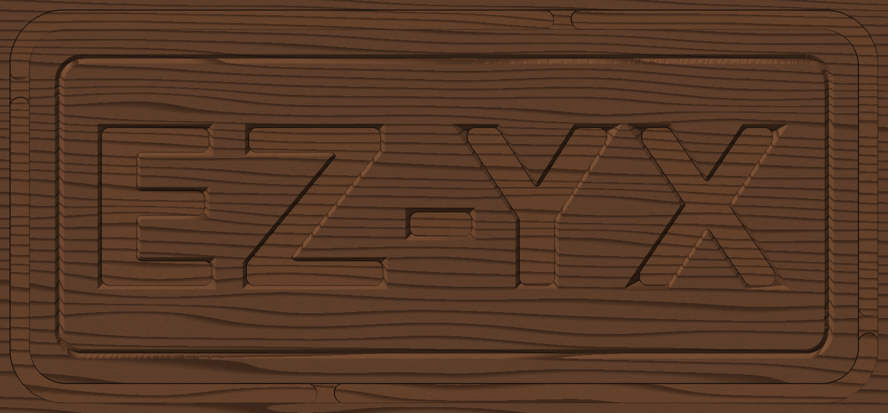

# Getting started

This chapter gets EZ-YX-craft onto your computer and takes you through a first job from start to
finish. Plan on about 15 minutes, plus machine time.

## Install EZ-YX-craft

**Installers.** Download the installer for your system from the project's
[releases page](https://github.com/aashiquear/EZ-YX-craft/releases):

- **Linux (Ubuntu):** the `.deb` package or the `.AppImage`.
- **macOS:** the `.dmg` disk image.
- **Windows:** the `.msi` or `.exe` installer.

**From source.** If you prefer to build it yourself:

1. Install Rust 1.85 or newer from [rustup.rs](https://rustup.rs).
2. On Ubuntu, install the graphics libraries:

   ```bash
   sudo apt install build-essential pkg-config libxkbcommon-dev libwayland-dev libx11-dev \
     libxcursor-dev libxrandr-dev libxi-dev libgl1-mesa-dev
   ```

3. In the source folder, run `cargo run -p ezyx-app --release`.

> **Tip:** On older graphics cards (for example AMD Radeon HD "TeraScale" models) start the app with
> `EZYX_GPU_BACKEND=gl` to use OpenGL instead of Vulkan.

## Your first job

The source folder includes a sample project, `examples/oak_sign.ezyx`: a walnut sign with V-carved
lettering, an engraved border and a cut-out. It is a good way to see every step of the pipeline.

1. Start EZ-YX-craft and open `examples/oak_sign.ezyx` (**File › Open…**).
2. **① Stock:** check the size and material of the board. The sample is a 300 × 140 × 18 mm walnut
   board with Z = 0 on the top surface. Change the numbers to match the board you actually have.
3. **② Design:** the timeline on the left shows three features — *Lettering* (V-carve), *Border groove*
   (engrave) and *Cut out*. Click one to see its strategy and depth on the right.
4. **③ Toolpaths:** every feature already has its roughing and finishing passes, with bits chosen for
   you. Select a feature to change a bit, then click **🎨 Final render** to see the result in walnut.
5. **④ Output:** choose the post-processor for your machine (for example *genmitsu_grbl*), check the
   summary, and click **💾 Download G-code** — or **🎮 Send to Machine Control**.

To start your own job, use **File › New**, pick a **Quick stock** preset in ① Stock, draw a few shapes
in ② Design and press a **Carve** button. See [The carving pipeline](pipeline/index.md).

> **Tip:** The preview shows the stock *after* cutting, rendered in the material you picked. It is
> the quickest way to spot a depth that is too deep or a bit that is too large for the detail.

## Check the result without the GUI

EZ-YX-craft also has a command-line tool, `ezyx`, which runs the same engine. It is handy for a quick
check that everything works, or for scripting:

```bash
ezyx demo -o demo.ezyx          # create the demo project
ezyx gcode demo.ezyx -o demo.nc # write G-code for it
ezyx sim demo.ezyx -o preview.png
```

The last command renders the predicted result as an image, like this one:



## Run the job on your machine

> **Warning:** A CNC machine can injure you. Clamp the stock firmly, wear eye and hearing protection,
> keep your hands clear of the spindle, and know where the emergency stop is before you start a job.

1. Fit the bit that the first toolpath asks for (the summary in ④ Output lists the bits in order).
2. In ④ Output click **🎮 Send to Machine Control**. In the Machine Control window connect over USB,
   over Wi-Fi, or to the built-in simulator if you want to practise first.
3. Jog the bit to your X/Y origin and to the top of the stock, and set zero there (or use the touch
   plate with **⬇ Probe Z**).
4. Select the job and click **▶ Run**. Stay with the machine while it runs.
See [Machine Control](machine/index.md).

## Optional: the AI assistant

The assistant can carry out tasks for you, such as "add a 6 mm border 10 mm inside the edge" or
"pick a bit for this pocket". To use it, open the settings and choose a provider: Claude or OpenAI
(you need an API key), or a local Ollama model (free, runs on your computer). Every change the
assistant makes can be undone, and it always asks before it moves the machine or writes a file.
