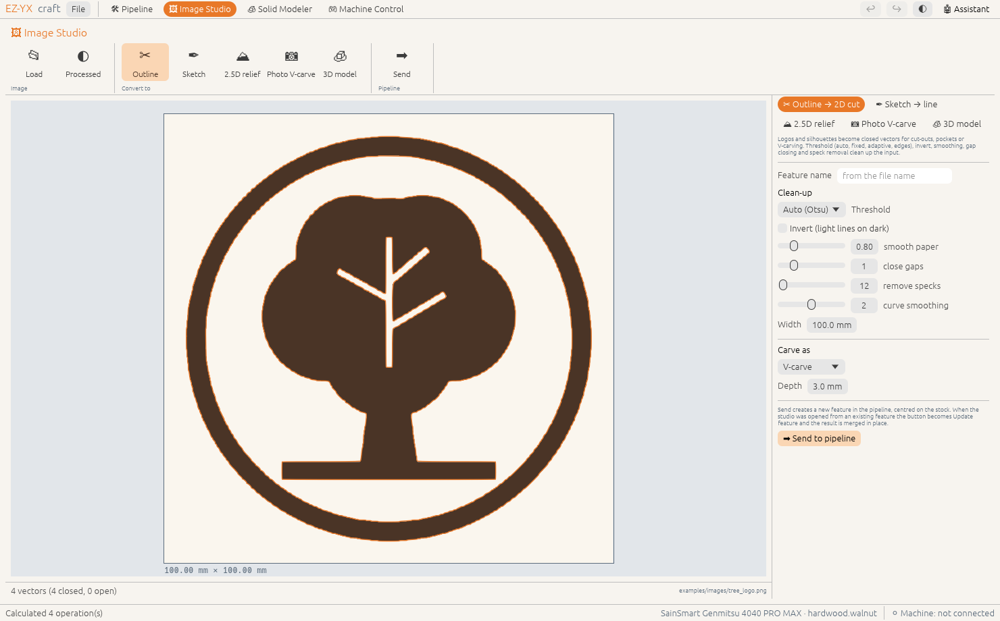

# Image Studio

The Image Studio turns pictures into things you can carve: logos and silhouettes into 2D cuts, pen
sketches into single engraved lines, greyscale images into 2.5D reliefs, photos into V-carved
grooves, and silhouettes into 3D models. It runs in its own window, so you can tune a conversion while
the pipeline stays in view.

<!-- feature:image.studio -->
## Open the studio and load a picture

Its own window with an image viewer, a live processing preview and the conversion settings. Open it
from the Design step or the module buttons at the top; it can sit next to the main window.

**Steps**

1. Click **🖼 Image Studio** in the top bar (or **② Design › Bring in › Image**).
2. Click **📂 Load** and pick a photo, sketch or logo (PNG, JPEG, BMP, GIF, TIFF, WebP).
3. Choose a conversion in **Convert to** and tune it while watching the preview. **◐** switches between
   the original and the processed image.

*Available since version 0.2.0.*
<!-- /feature:image.studio -->

<!-- feature:image.outline -->
## Trace outline → 2D cut

Logos and silhouettes become closed vectors for cut-outs, pockets or V-carving. Threshold (auto,
fixed, adaptive, edges), invert, smoothing, gap closing and speck removal clean up the input.

**Steps**

1. Choose **✂ Outline**.
2. Tune **Threshold** until the dark shapes in the preview are the ones you want. The traced vectors
   are drawn in orange on top.
3. Set the **Width** of the result, pick **Carve as** (V-carve, pocket, cut out, inside cut, engrave)
   and the **Depth**.
4. Click **➡ Send to pipeline**.

> **Tip:** White holes inside dark shapes (like the counter of an "O") become holes in the vectors, so
> a pocket or V-carve leaves them standing.

*Available since version 0.2.0.*
<!-- /feature:image.outline -->

<!-- feature:image.sketch -->
## Sketch → single line

Pen and pencil drawings become single centre-line paths for engraving.

**Steps**

1. Choose **✒ Sketch**.
2. For pencil on uneven paper use **Adaptive** threshold, raise **smooth paper** and **close gaps**.
3. Send to the pipeline — the feature is created as **Engrave**.

*Available since version 0.2.0.*
<!-- /feature:image.sketch -->

<!-- feature:image.relief -->
## Image → 2.5D relief

Greyscale becomes height: bright = high (or the reverse), with gamma, smoothing, background
flattening, size and depth. The preview shows the height map.

**Steps**

1. Choose **⛰ 2.5D relief**.
2. Set **Width**, **Depth** and **Resolution**; adjust **gamma** to lift or press the mid-tones.
3. Send to the pipeline. It is carved with 3D roughing and a ball-nose finish.

*Available since version 0.2.0.*
<!-- /feature:image.relief -->

<!-- feature:image.photo_vcarve -->
## Photo V-carve

Shaded photos become V-grooves whose depth follows the darkness, as lines, waves or circles.

**Steps**

1. Choose **📷 Photo V-carve**.
2. Choose the **V-bit** angle, **Line spacing** and pattern; adjust contrast and gamma.
3. The panel shows the depth of the darkest groove. Send to the pipeline.

*Available since version 0.2.0.*
<!-- /feature:image.photo_vcarve -->

<!-- feature:image.to3d -->
## Image → 3D model

A silhouette (transparent PNGs work best) is inflated into a rounded 3D model that is carved
top-down. AI image-to-3D services can be plugged in.

**Steps**

1. Choose **🧊 3D model**.
2. Check the silhouette in the preview and set the **3D thickness**.
3. Send to the pipeline as a 3D model feature.

*Available since version 0.2.0.*
<!-- /feature:image.to3d -->

<!-- feature:image.send -->
## Send to pipeline / update feature

**Send** creates a new feature in the pipeline, centred on the stock. When the studio was opened from
an existing feature the button becomes **⟳ Update** and the result is merged in place — same position,
same bit choices — with a merge report. **➕ As new** sends a separate feature instead.

**Steps**

1. Click **➡ Send** (new feature) or **⟳ Update** (new revision).
2. Switch to the pipeline window to see the feature in the timeline.

*Available since version 0.2.0.*
<!-- /feature:image.send -->
