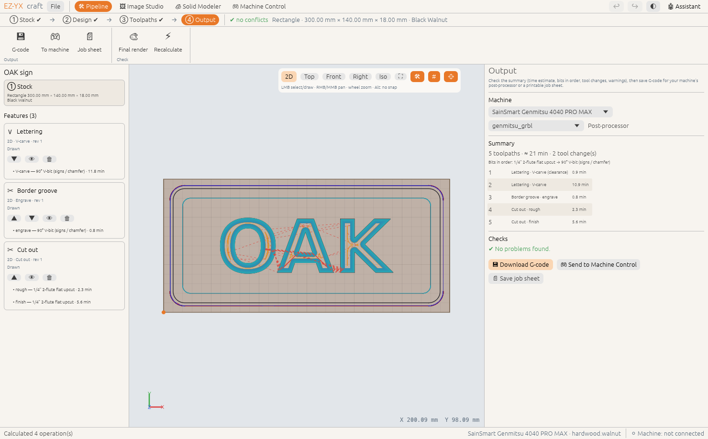

# ④ Output

The last step turns the plan into something your machine runs: a G-code file for its post-processor,
a printable job sheet, or a job handed straight to Machine Control.

<!-- feature:pipeline.output -->
## G-code & job sheet

Check the summary (time estimate, bits in order, tool changes, warnings), then save G-code for your
machine's post-processor or a printable job sheet.

**Steps**

1. Open **④ Output**.
2. Confirm the **Machine** and **Post-processor** (for example *genmitsu_grbl* for a Genmitsu
   router, *grbl* for most GRBL machines).
3. Read the **Summary** — every toolpath in run order with its time — and the **Checks**.
4. Click **💾 Download G-code** and choose where to save it. **📄 Save job sheet** writes an HTML page
   with the stock, datum, bits in order, depths and feeds to print for the workshop.

> **Warning:** If the checks list errors (✖), fix them first — or export anyway only if you know why
> they are there. A feature deeper than the stock cuts into your spoilboard.

*Available since version 0.2.0.*
<!-- /feature:pipeline.output -->

<!-- feature:pipeline.send_machine -->
## Send to Machine Control

Hand the G-code straight to the Machine Control window, which opens with the job loaded and selected,
ready to run. Sending again replaces the previous pipeline job in the queue.

**Steps**

1. Open **④ Output**.
2. Click **🎮 Send to Machine Control**.
3. In Machine Control, connect, set zero and press **▶ Run**. See [Machine Control](../machine/index.md).

*Available since version 0.2.0.*
<!-- /feature:pipeline.send_machine -->

## Tool changes

The summary counts tool changes. Hobby GRBL machines have no tool changer: their posts lift the
spindle, stop it and pause with `M0` and a comment naming the next bit. Change the bit, re-zero Z
(use the touch plate in Machine Control) and resume. Posts for machines with a changer (Makera
Carvera, LinuxCNC) emit `M6 T#` instead. To keep tool
changes down, give features that are cut one after another the same bit in ③ Toolpaths.
