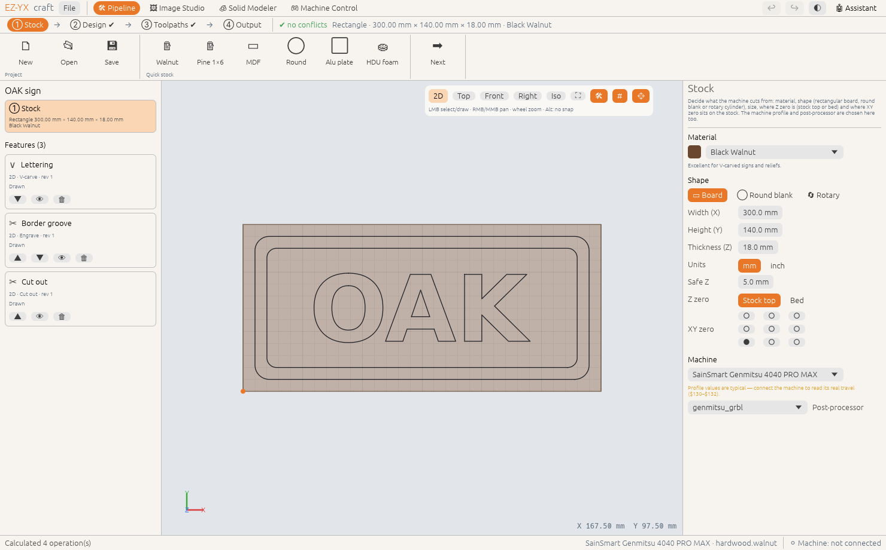

# Stock setup

The first step describes the material you are going to carve. Everything else — toolpath depths,
conflict checks, feeds and speeds, the rendered preview — is worked out from it, so it is worth a
minute to get right.

<!-- feature:pipeline.stock -->
Decide what the machine cuts from: material, shape (rectangular board, round blank or rotary
cylinder), size, where Z zero is (stock top or bed) and where XY zero sits on the stock. The machine
profile and post-processor are chosen here too.

**Steps**

1. Open **① Stock**.
2. Pick a **Material**. Its colour is used for the rendered preview, and its group (softwood,
   hardwood, MDF, aluminium…) for the recommended feeds and speeds.
3. Choose the **Shape** — **▭ Board**, **◯ Round blank** or **🔄 Rotary** — and type the width,
   height and thickness (or the diameter).
4. Choose **Z zero**: **Stock top** (most common) or **Bed**.
5. Click a dot in the **XY zero** grid to set where X0 Y0 is on the stock. The orange dot in the
   viewer shows it.
6. Choose your **Machine**. The matching **Post-processor** is selected for you.

*Available since version 0.2.0.*
<!-- /feature:pipeline.stock -->

## Quick stock presets

The **Quick stock** group in the ribbon sets material, size and shape in one click: a walnut sign
board, a pine 1×6, an MDF sheet, a round maple blank, an aluminium plate or HDU sign foam. Start from
the closest one and adjust the numbers.

## Measure, don't guess

> **Tip:** Measure the thickness of your board with calipers in a few places and enter the smallest
> value. Cut-outs are planned to the full thickness, so a board that is thinner than you entered is
> cut deeper into your spoilboard; a thicker one leaves an uncut skin.

> **Warning:** If the stock is larger than your machine's travel, the panel says so. Machine profiles
> marked *typical values* should be checked against your controller: connect in **Machine Control**
> and use **Use in profile** to copy the real travel from GRBL settings `$130`–`$132`.
