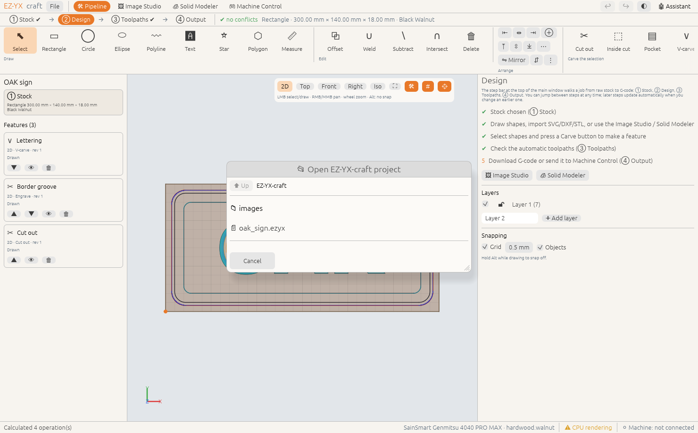

# Windows, layout & settings

<!-- feature:settings.windows -->
## Module windows side by side

Image Studio, Solid Modeler and Machine Control open as their own windows so they can sit next to the
pipeline. **⧉ Tile** places the open windows side by side; a preference shows them inside the main
window instead, as tabs next to **🛠 Pipeline**.

**Steps**

1. Open a module from the top bar (buttons marked ↗ open a window).
2. Click **⧉ Tile** to arrange the main window and the open modules across the screen.
3. **File › ⚙ Settings › Windows** to choose separate windows or tabs inside the main window.

*Available since version 0.2.0.*
<!-- /feature:settings.windows -->

<!-- feature:settings.graphics -->
## Graphics: GPU checks and CPU fallback

At start-up EZ-YX-craft checks the graphics adapters. GPUs that can't run the viewport (no driver,
tiny buffer or texture limits, can't draw to the window) are skipped, and if none is usable the app
renders on the CPU instead and tells you why. While you work, previews are sized to the GPU's buffer
limit; if the GPU still runs out of memory the app simplifies the view and offers to restart with CPU
rendering instead of crashing.

**Steps**

1. If a **⚠ Graphics** message appears, read why and choose **Restart with CPU rendering** (tick
   **always** to keep it) or **OK**.
2. **File › ⚙ Settings › Graphics** shows the adapter in use, its largest buffer and the preview
   budgets.
3. Choose **Render with**: **Auto**, **GPU** or **CPU**, then click **Restart now**. You can also start
   once in a mode with `EZYX_RENDER=cpu ez-yx-craft`.
4. **Graphics API** picks Vulkan, DirectX 12, Metal or OpenGL (**Auto** uses the best);
   **Simplified previews** halves the GPU memory the views use. Tablets have no CPU renderer
   and can't restart themselves: these settings apply the next time you open the app.

What the app does for you:

| Situation | What happens |
|---|---|
| No GPU driver, or the system fell back to a software renderer | CPU rendering, ⚠ notice, **⚠ CPU rendering** in the status bar |
| GPU below the minimum limits (64 MiB buffers, 4096 px textures) | Skipped; the next GPU or the CPU renderer is used |
| GPU only reachable through OpenGL | Used, with a note to install the vendor's Vulkan/DirectX driver |
| Simulation would need more memory than allowed | The simulation cell is coarsened and the preview says so |
| A preview would exceed the GPU's buffer limit | Drawn simplified (**◇ simplified view** in the status bar) |
| The GPU runs out of memory or rejects a buffer | Budgets are halved, the view is simplified, you're offered a CPU restart |
| The GPU device is lost or the renderer crashes | Your project is saved to a recovery copy and the app restarts with CPU rendering |
| Tablet: the graphics driver crashed | Next start uses simplified previews (and OpenGL ES on Android) and reopens the recovery copy |

> **Tip:** After a restart the recovered project has no file name — use **File › Save as…** to keep
> it. A recovery copy is written at most once a minute while you work.

*Available since version 0.2.0.*
<!-- /feature:settings.graphics -->

<!-- feature:settings.general -->
## Units, theme & performance

Millimetres or inches, light or dark theme, snapping, and simulation detail (set from your GPU tier).

**Steps**

1. **File › ⚙ Settings** for windows, snapping and the simulation cell size.
2. **🌓** in the top bar switches between light and dark.
3. Units are part of the job: **① Stock › Units**.

> **Tip:** On older graphics cards start the app with `EZYX_GPU_BACKEND=gl` to use OpenGL.

*Available since version 0.2.0.*
<!-- /feature:settings.general -->

<!-- feature:settings.tablets -->
## iPad and Android tablets

The same EZ-YX-craft runs on iPad and Android tablets, with the same pipeline, modules, simulation
and Machine Control. A few things work differently on a tablet:

* **One window.** Image Studio, Solid Modeler and Machine Control open as tabs next to
  **🛠 Pipeline**.
* **Touch.** See the table below. A keyboard and mouse or trackpad work as on a computer.
* **Files.** Files live in the app's own folder, and **Open**, **Save** and the imports use an
  in-app file browser.
* **Wi-Fi only.** Tablets can't open USB serial ports, so connect to the machine with
  **📶 Wi-Fi TCP** or **📶 WebSocket**.

**Steps**

1. Install the app: the **iPad** `.ipa` or the **Android** `.apk` from the release page (or
   TestFlight / Google Play when published).
2. Copy projects, SVG/DXF files, images and G-code into the app's folder:
   * **iPad:** Files app › **On My iPad › EZ-YX-craft** (AirDrop or **Share › Save to Files**
     work too).
   * **Android:** `Android/data/org.ezyxcraft.app/files` over USB or with a file manager.
3. Open and save from the in-app file browser (**📂 Open** / **💾 Save**). Tap a folder to go
   into it and **⬆ Up** to come back.

4. In **Machine Control** choose **📶 Wi-Fi TCP** or **📶 WebSocket**, enter the controller's
   address and **Connect**. On iPad, allow **Local Network** access when asked.

| Gesture | In 3D views | In the 2D design view |
|---|---|---|
| One finger drag | Orbit | Select / draw (like the left mouse button) |
| Two fingers drag | Pan | Pan |
| Pinch | Zoom | Zoom |
| Two-finger twist | Turn the view | — |

> **Tip:** If the 3D view glitches or the app closes while drawing, choose **Use safe graphics**
> in the ⚠ Graphics message, or tick **Simplified previews** in **⚙ Settings › Graphics** (on
> Android you can also pick **OpenGL ES** there). After a graphics crash the app starts in safe
> mode by itself and reopens your work.

*Available since version 0.2.0.*
<!-- /feature:settings.tablets -->
