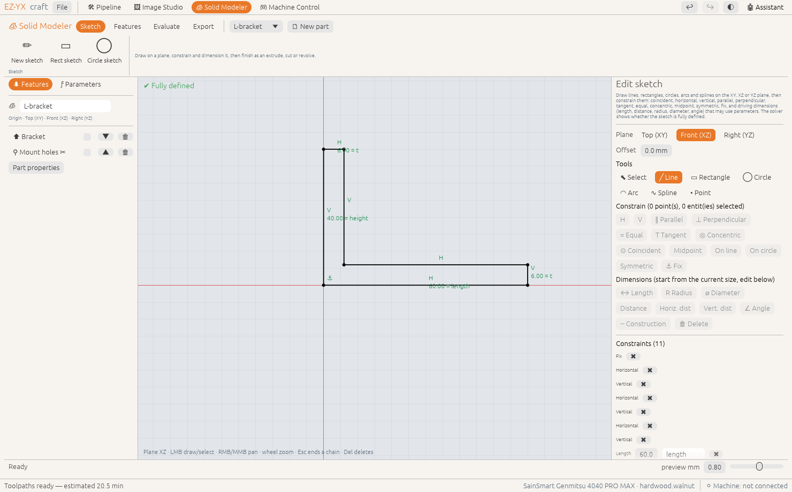

# Sketches & constraints

Most parts start from a 2D sketch. You draw rough geometry, then **constrain** it — say which lines are
horizontal, which points coincide, how long an edge is — and the solver moves everything into place.
A sketch whose shape is completely determined is **fully defined**.

<!-- feature:solid.sketch -->
## Draw and constrain a sketch

Draw lines, rectangles, circles, arcs and splines on the XY, XZ or YZ plane, then constrain them:
coincident, horizontal, vertical, parallel, perpendicular, tangent, equal, concentric, midpoint,
symmetric, fix, and driving dimensions (length, distance, horizontal/vertical distance, radius,
diameter, angle) that may use parameters. The solver shows whether the sketch is fully defined.

**Steps**

1. **Sketch › ✏ New sketch** (or start from **▭ Rect sketch** / **◯ Circle sketch**). Pick the
   **Plane**: **Top (XY)**, **Front (XZ)** or **Right (YZ)**, and an **Offset** if needed.
2. Draw with the tools: **╱ Line** (click point after point; clicking an existing point reuses it,
   `Esc` or right-click ends the chain), **▭ Rectangle**, **◯ Circle**, **◠ Arc** (centre, start,
   end), **∿ Spline** (double-click to finish), **• Point**. Nearly horizontal or vertical lines get
   that constraint automatically.
3. Switch to **⬉ Select**, click entities or points (`Shift` to add) and press a constraint button.
   Only the buttons that fit the selection are enabled.
4. Add **Dimensions**. They start at the current size; edit the value in the **Constraints** list, or
   type an expression such as `width/2` or `(1/4)in` to drive it with a parameter.
5. Watch the status in the canvas:
   - **Under-defined** (blue geometry): the number of degrees of freedom left.
   - **✔ Fully defined** (black geometry).
   - **⚠ Over-defined**: a redundant or conflicting constraint — delete one.
6. Choose **Boss**, **Cut** or **Intersect**, the **Depth**, and click **⬆ Extrude** or **🔄 Revolve**.
   When editing an existing feature's sketch click **✔ Apply sketch**.

*Available since version 0.2.0.*
<!-- /feature:solid.sketch -->

## Constraint reference

| Select | Constraints |
|---|---|
| one or more lines | **H** (horizontal), **V** (vertical), **↔ Length** |
| two lines | **∥ Parallel**, **⊥ Perpendicular**, **= Equal**, **∠ Angle** |
| a circle or arc | **R Radius**, **⌀ Diameter** |
| two circles/arcs | **= Equal**, **◎ Concentric**, **T Tangent** |
| a line and a circle/arc | **T Tangent** |
| two points | **⊙ Coincident**, **Distance**, **Horiz. dist**, **Vert. dist** |
| a point and a line | **Midpoint**, **On line** |
| a point and a circle | **On circle** |
| two points and a line | **Symmetric** |
| points | **⚓ Fix** |

> **Tip:** Mark helper geometry (a centre line for a symmetric constraint, say) as **┄ Construction**.
> It guides the solver but is not part of the profile that gets extruded.
